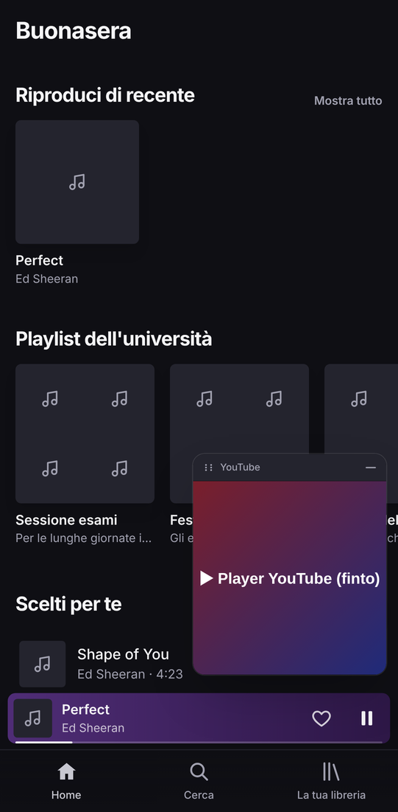
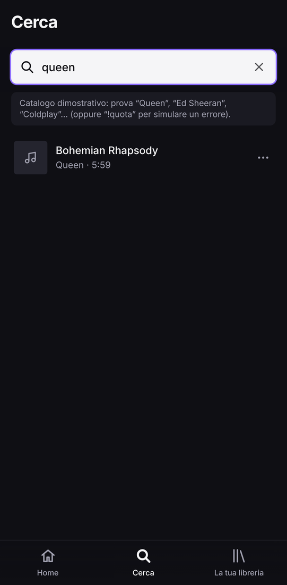
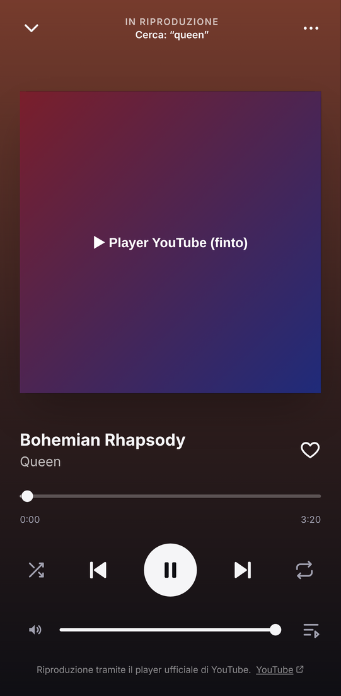
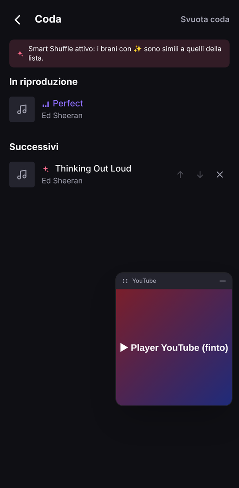

# UniTune

PWA mobile per studenti universitari con un'esperienza d'ascolto "da app musicale" (coda, playlist condivise, player persistente, preferiti, cronologia, **Smart Shuffle**) costruita solo con API ufficiali e legali, su **due fonti musicali**:

| Fonte | Come suona | Schermo spento / app in background |
|---|---|---|
| **YouTube** | solo tramite il player IFrame ufficiale, sempre visibile | ❌ si ferma (lo impone YouTube) |
| **Audius** 🌙 | streaming audio tramite l'API pubblica di Audius | ✅ continua, con i controlli della schermata di blocco |

Progetto accademico · React 19 + Vite + TypeScript strict + Tailwind 4 + Zustand + Supabase + vite-plugin-pwa.

| Home | Ricerca (YouTube + Audius) | Player | Smart Shuffle |
|---|---|---|---|
|  |  |  |  |

<sub>Screenshot generati dal test end-to-end, in cui il player di YouTube è sostituito da un segnaposto e le copertine non vengono caricate.</sub>

---

## Indice

1. [Avvio rapido (modalità demo)](#1-avvio-rapido-modalità-demo)
2. [Rispetto dei Termini di Servizio di YouTube](#2-rispetto-dei-termini-di-servizio-di-youtube) · [Audius](#audius-la-seconda-fonte) · [Smart Shuffle](#smart-shuffle)
3. [Limiti noti e alternative scelte](#3-limiti-noti-e-alternative-scelte)
4. [Architettura](#4-architettura)
5. [Configurare Supabase](#5-configurare-supabase)
6. [Configurare la YouTube Data API key](#6-configurare-la-youtube-data-api-key)
7. [Deploy della Edge Function](#7-deploy-della-edge-function)
8. [Deploy del frontend (Vercel / Netlify)](#8-deploy-del-frontend-vercel--netlify)
9. [Quota della YouTube Data API](#9-quota-della-youtube-data-api)
10. [Test](#10-test)
11. [Variabili d'ambiente](#11-variabili-dambiente)

---

## 1. Avvio rapido (modalità demo)

Requisiti: Node.js 22+.

```bash
npm install
npm run dev
```

Apri http://localhost:5173. Senza alcuna configurazione l'app parte in **modalità demo**:

- nessun account: i dati (playlist, preferiti, cronologia) restano nel `localStorage` del dispositivo;
- la ricerca **YouTube** usa un **catalogo dimostrativo** (`src/api/fixtures.ts`) e non consuma quota;
- la ricerca **Audius** è già reale: la sua API pubblica non richiede chiavi;
- la riproduzione usa comunque il **vero player IFrame di YouTube**.

Query speciali nella ricerca demo per provare la gestione errori: `!quota`, `!rete`, `!offline`, `!errore`.

Per usare account reali e ricerca reale segui i passi 5–7.

---

## 2. Rispetto dei Termini di Servizio di YouTube

Riferimenti: [YouTube Terms of Service](https://www.youtube.com/t/terms) · [YouTube API Services Terms of Service](https://developers.google.com/youtube/terms/api-services-terms-of-service) · [Developer Policies](https://developers.google.com/youtube/terms/developer-policies) · [Required Minimum Functionality](https://developers.google.com/youtube/terms/required-minimum-functionality).

### Cosa facciamo

| Regola | Come la rispettiamo | Dove |
|---|---|---|
| Riprodurre contenuti solo con il player incorporato ufficiale | Unico `<iframe>` creato dalla **YouTube IFrame Player API**, comandato solo con i suoi metodi pubblici (`loadVideoById`, `playVideo`, `seekTo`…) | `src/player/YouTubePlayer.ts` |
| Nessun download, estrazione, transcodifica o proxy degli stream | Nessuna libreria di estrazione. Il service worker **non** mette in cache nulla di YouTube | `src/sw.ts` |
| Non separare l'audio dal video, non nascondere il player | Il player è **sempre visibile e almeno 200×200 px mentre suona**: nel player a schermo intero il video *è* la copertina; altrove un riquadro flottante di 200×200 px. Ridurlo lo **mette in pausa** | `src/components/PlayerHost.tsx`, `usePlayerStore.setFloatingCollapsed` |
| Non coprire il player | Quando si apre un pannello, il player flottante si sposta in alto. Nessun elemento è sovrapposto all'iframe; i controlli nativi di YouTube restano attivi (`controls=1`) | `PlayerHost`, `BottomSheet` |
| Metadati solo dalla YouTube Data API v3 | `search.list` (`type=video`, `videoCategoryId=10`) + `videos.list`; filtri ufficiali `videoEmbeddable=true` e `videoSyndicated=true` | `supabase/functions/_shared/youtube-core.ts` |
| Rispettare la quota, senza aggirarla | Cache condivisa (≤ 30 giorni, default 24 h), tetto ricerche per utente, cache client, attesa fino al reset dopo una quota esaurita. **Una sola** chiave e un solo progetto Google | `handler.ts`, `src/api/youtube.ts` |
| Rispettare la scelta del creator di non consentire l'embed | Gli errori 101/150 mostrano "Il creator non consente la riproduzione fuori da YouTube" con link a youtube.com, e si passa al brano successivo | `PlayerErrorBanner.tsx` |
| Informare gli utenti dei Termini di YouTube e dell'informativa privacy di Google | Avviso con link nella pagina di accesso | `LoginPage.tsx` (`LegalNotice`) |
| Attribuzione | Link "Apri su YouTube" in ogni brano e nel player | `TrackActionsSheet`, `PlayerScreen` |

### Perché l'IFrame API e non altre soluzioni

Le soluzioni che riproducono "solo l'audio" di YouTube, o lo fanno in background con un `<audio>` proprio, si basano tutte sull'estrazione dello stream. È vietata dai Termini e fragile, perché YouTube la blocca attivamente. L'IFrame API è l'**unico** modo consentito di riprodurre i contenuti in un'app di terzi. Tutte le scelte di questo progetto derivano da qui, compresi i limiti della sezione 3. Il commento in testa a `src/player/YouTubePlayer.ts` riassume il motivo nel codice.

### Audius, la seconda fonte

L'ascolto in background non è possibile con YouTube (sezione 3). L'alternativa legittima più vicina è una seconda fonte che **consente** lo streaming audio nelle app di terzi: [Audius](https://audius.co), un catalogo musicale aperto con API pubblica e gratuita (`https://api.audius.co/v1`, nessuna chiave; l'app si identifica con `app_name`).

- Ricerca: `/tracks/search`; brani simili: `/tracks/trending?genre=…`; audio: `/tracks/{id}/stream` (redirect al file).
- Si mostrano solo i brani con `is_streamable=true` e non riservati (`is_stream_gated`).
- **Attribuzione:** nome dell'artista ed etichetta "Audius" su ogni brano, link "Apri su Audius" / "Brano su Audius".
- I brani Audius suonano con un elemento `<audio>` (`src/player/backends.ts` → `AudioBackend`), quindi continuano a schermo spento e la Media Session funziona davvero.
- **Compromesso:** Audius ha soprattutto artisti indipendenti (elettronica, hip hop, lo-fi…), non il catalogo delle grandi case discografiche.

In background, a fine brano, l'app **salta i brani YouTube** della coda e passa al prossimo brano Audius (`nextBackgroundIndex` in `src/player/queue.ts`). Non aggira nulla: semplicemente non prova a riprodurre YouTube dove non è permesso.

### Smart Shuffle

Come nelle app musicali: il pulsante "casuale" ha tre stati (**spento → casuale → Smart Shuffle ✨**). In Smart Shuffle, mentre ascolti una lista in ordine casuale, l'app inserisce **un brano simile ogni 3**, segnato con ✨. Se la lista è una tua playlist, puoi aggiungere il brano consigliato con un tocco.

- "Simile" = stesso artista (peso maggiore), stesso genere (Audius), stessa fonte (`src/lib/smartShuffle.ts`, funzioni pure testate).
- Candidati, dal più economico (`src/player/smartShuffleSource.ts`): libreria dell'utente → Audius (gratis) → **al massimo 1** ricerca YouTube sull'artista principale, con cache di 12 h (rispetto della quota).
- Al massimo 2 brani consigliati per artista; disattivandolo, i consigliati non ancora ascoltati spariscono dalla coda.

### Prima di una pubblicazione reale

- **Informativa privacy dell'app:** le Developer Policies la richiedono a ogni client che usa le API Services. Deve citare l'uso delle YouTube API Services e rimandare a https://policies.google.com/privacy.
- **Audit di conformità:** serve per chiedere più quota (sezione 9).
- **Nome e logo:** UniTune usa nome, logo e palette propri. Prende spunto dall'esperienza d'uso delle app musicali senza copiarne marchi o grafica, e non usa il logo di YouTube come icona.

---

## 3. Limiti noti e alternative scelte

| Desiderio | Perché non è possibile con le API ufficiali | Alternativa adottata | Compromesso |
|---|---|---|---|
| Player nascosto (1×1 px) che "suona in sottofondo" | Le policy richiedono un player visibile di almeno 200×200 px e vietano l'ascolto solo audio | **Soluzione A:** il video fa da copertina a schermo intero; altrove c'è un player flottante di 200×200 px, trascinabile a sinistra o a destra e riducibile (ridurlo lo mette in pausa) | Il riquadro occupa spazio: le pagine hanno un margine in fondo per poter scorrere oltre |
| Riproduzione in background / schermo bloccato | Il browser mette in pausa l'iframe quando l'app va in background. Su YouTube il background è una funzione di YouTube Premium | **Seconda fonte, Audius** 🌙, che si ascolta anche a schermo spento; in background la coda salta i brani YouTube. Nessun aggiramento per YouTube | Audius ha soprattutto artisti indipendenti |
| Controlli sulla schermata di blocco (Media Session) | Per YouTube l'audio esce da un iframe di un altro dominio: alcuni browser mostrano i metadati di YouTube o ignorano quelli della pagina | Media Session completa per i brani Audius; per YouTube è un miglioramento progressivo | Per YouTube il comportamento dipende dal browser |
| Volume | Su iOS il volume si controlla solo con i tasti fisici; `setVolume` viene ignorato | Lo slider del volume è nascosto su iOS | — |
| Autoplay | I browser mobili possono bloccare l'avvio senza un tocco | Evento `onAutoplayBlocked` più un controllo dopo 5 secondi: messaggio "tocca il video per iniziare" (il player è visibile, quindi si può toccare) | Un tocco in più la prima volta |
| "Brani simili" per i suggerimenti | `relatedToVideoId` è stato rimosso dalla Data API (2023); ogni ricerca costa 100 unità | Suggerimenti calcolati in locale da cronologia e preferiti, più **una** ricerca ogni 12 h sull'artista più ascoltato | Suggerimenti "basici", come da requisito |
| Musica offline | Salvare contenuti YouTube è vietato | Offline funzionano la shell e l'ultima sessione: libreria, playlist aperte e coda sono consultabili, con il messaggio "Connessione richiesta per riprodurre" | Per ascoltare serve la rete |
| Playlist "dell'università" curate | Un solo utente per ora (scelta di progetto) | Qualsiasi playlist pubblica può essere segnata "dell'università" | In futuro: ruolo "curatore" nelle policy RLS |

---

## 4. Architettura

```
Browser (PWA)
├─ React UI ── Zustand ─┬─ usePlayerStore (coda, stato, intenzioni) ──► usePlayerEngine ─┬─► YouTubeBackend ──► <iframe youtube.com>
│                       │                                                                └─► AudioBackend ────► <audio> (stream Audius)
│                       ├─ useLibraryStore (playlist, preferiti, cronologia; persistito per l'offline)
│                       └─ useAuthStore
├─ src/api/audius.ts ───── GET https://api.audius.co/v1 (pubblica, nessuna chiave)
├─ src/api/youtube.ts ──── POST /functions/v1/youtube (JWT utente) ──┐
├─ Supabase JS (Auth + PostgREST, RLS) ──────────────────────────────┤
└─ Service worker (solo shell statica)                               │
                                                                     ▼
Supabase
├─ Postgres: profiles, playlists, playlist_tracks, playlist_saves, favorites, history
│            yt_cache, api_usage (solo service_role)
└─ Edge Function `youtube` ── YOUTUBE_API_KEY (secret) ──► YouTube Data API v3 (search.list + videos.list)
```

### Struttura

```
src/
├─ api/
│  ├─ youtube.ts          client tipizzato: errori, cache, rate limit, attesa dopo quota esaurita (+ mock)
│  ├─ audius.ts           client Audius: ricerca, tendenze per genere, URL dello stream
│  ├─ client.ts           sceglie client YouTube reale o dimostrativo
│  └─ fixtures.ts         catalogo dimostrativo
├─ player/
│  ├─ YouTubePlayer.ts    wrapper tipizzato sull'IFrame API (+ mappatura errori 2/5/100/101/150/153)
│  ├─ ytTypes.ts          tipi dell'IFrame API
│  ├─ backends.ts         motori: YouTubeBackend (IFrame) e AudioBackend (<audio> per Audius)
│  ├─ queue.ts            logica della coda, Smart Shuffle, scelta del brano in background (funzioni pure, testate)
│  ├─ smartShuffleSource.ts  raccolta dei brani simili (libreria, Audius, 1 ricerca YouTube)
│  ├─ usePlayerStore.ts   store Zustand: coda, stato, intenzioni per il motore
│  ├─ usePlayerEngine.ts  collega lo store all'unico iframe; registra la cronologia (30 s)
│  ├─ useMediaSession.ts  Media Session API
│  └─ usePlayerLayout.ts  posizione dell'iframe (schermo intero / flottante)
├─ data/                  repository (Supabase | locale) + store della libreria
├─ auth/                  store auth (email/password, magic link, demo) + protezione rotte
├─ components/            MiniPlayer, PlayerHost, BottomSheet, TrackRow, …
├─ pages/                 Home, Cerca, Libreria, Playlist, PlayerScreen, Coda, Login, Onboarding
├─ lib/                   supabase.ts, config, raccomandazioni, utilità
├─ pwa/                   prompt di installazione
├─ i18n/it.ts             tutti i testi (pronto per altre lingue)
└─ sw.ts                  service worker (injectManifest)
supabase/
├─ migrations/            schema + RLS
├─ functions/youtube/     Edge Function (Deno)
├─ functions/_shared/     contratto client↔server + logica pura testabile
└─ tests/                 test SQL (RLS) e test della funzione
e2e/                      test end-to-end (Playwright)
```

### Scelte principali

- **Un solo iframe, mai smontato.** Spostare un iframe nel DOM lo ricarica. `PlayerHost` resta montato e cambia solo la posizione CSS: sopra il riquadro della `PlayerScreen` oppure flottante.
- **Store e motore separati.** Lo store contiene stato e *intenzioni* (es. "carica il brano X dal secondo 30"); il motore le traduce in chiamate all'IFrame API e rimanda gli eventi. La logica della coda è pura e testata.
- **Repository intercambiabili.** `SupabaseRepository` e `LocalRepository` implementano la stessa interfaccia, quindi la modalità demo non richiede rami speciali nell'interfaccia.
- **Contratto condiviso.** `supabase/functions/_shared/contract.ts` è importato sia dal frontend sia dalla funzione.

---

## 5. Configurare Supabase

1. Crea un progetto gratuito su https://supabase.com.
2. Applica lo schema (tre migrazioni, in ordine: schema + RLS, permessi espliciti, revoca delle funzioni trigger), in uno dei due modi:
   - **SQL Editor:** incolla ed esegui, in ordine, i file di `supabase/migrations/`;
   - **CLI:**
     ```bash
     npx supabase login
     npx supabase link --project-ref <id-progetto>
     npx supabase db push
     ```
3. **Authentication → Providers → Email:** lascia attivo Email. "Confirm email" va bene attivo; per i test può essere disattivato.
4. **Authentication → URL Configuration:**
   - *Site URL*: l'URL di produzione (es. `https://unitune.vercel.app`);
   - *Redirect URLs*: aggiungi `http://localhost:5173` e l'URL di produzione. Servono al **magic link**, che torna all'app con un codice PKCE che il client scambia automaticamente.
5. **Project Settings → API:** copia *Project URL* e la chiave *anon/publishable* in `.env`:
   ```bash
   cp .env.example .env
   ```

> I progetti Supabase recenti **non concedono più in automatico** i permessi sulle nuove tabelle ai ruoli dell'API: per questo la seconda migrazione (`*_explicit_grants.sql`) concede, tabella per tabella, solo le operazioni necessarie. Il test locale del database riproduce questo comportamento.

La anon key è pubblica per design: la sicurezza è nelle **policy RLS**, verificate da `npm run test:db`. La *service_role* key **non** va mai nel client: la usa solo la Edge Function, che la riceve automaticamente da Supabase.

---

## 6. Configurare la YouTube Data API key

1. https://console.cloud.google.com → crea un progetto (es. "UniTune").
2. **API e servizi → Libreria** → cerca **YouTube Data API v3** → **Abilita**.
3. **API e servizi → Credenziali → Crea credenziali → Chiave API**.
4. **Limita la chiave** (Modifica chiave API):
   - **Limitazioni dell'API:** *Limita chiave* → seleziona solo **YouTube Data API v3**;
   - **Limitazioni delle applicazioni:** vedi sotto.

### Restrizione per dominio: come funziona qui

La chiave **non** finisce mai nel browser: la usa solo la Edge Function. Per questo:

- la restrizione per **referrer HTTP** (dominio) di Google Cloud non è applicabile, perché le richieste partono dal server di Supabase, non da una pagina del tuo dominio. Anche la restrizione per IP non è praticabile: gli IP delle Edge Function non sono fissi;
- la restrizione per dominio è applicata **sulla funzione**:
  - `ALLOWED_ORIGINS` (CORS) accetta solo i domini dell'app;
  - `verify_jwt = true` accetta solo utenti autenticati sul tuo progetto Supabase;
  - un tetto giornaliero di ricerche per utente limita i consumi;
- la chiave resta limitata alla sola YouTube Data API v3: se trapelasse, non darebbe accesso ad altre API.

> **Se in futuro scegli una chiave lato client** (chiamate dirette dal browser), imposta *Limitazioni delle applicazioni → Siti web* con `https://tuo-dominio.app/*` e `http://localhost:5173/*`. In questo progetto è sconsigliato: la chiave sarebbe visibile nel bundle e si perderebbe la cache condivisa.

---

## 7. Deploy della Edge Function

```bash
npx supabase login
npx supabase link --project-ref <id-progetto>
```

```bash
npx supabase secrets set YOUTUBE_API_KEY=<chiave> ALLOWED_ORIGINS=https://tuo-dominio.app,http://localhost:5173
```

```bash
npx supabase functions deploy youtube
```

Poi in `.env` imposta `VITE_USE_MOCKS=false` per usare la ricerca reale.

Variabili opzionali della funzione: `YT_MAX_SEARCHES_PER_USER_DAY` (default 40), `YT_CACHE_TTL_HOURS` (default 24; per le policy massimo 720), `YT_REGION_CODE` (IT), `YT_RELEVANCE_LANGUAGE` (it).

Per provarla in locale (richiede Docker):

```bash
npx supabase start
```

```bash
npx supabase functions serve youtube --env-file .env
```

**Pulizia della cache scaduta** (facoltativa): esegui `select public.purge_expired_yt_cache();` periodicamente, per esempio con *Integrations → Cron* (pg_cron).

---

## 8. Deploy del frontend (Vercel / Netlify)

Entrambi i servizi sono già configurati: rewrite SPA, `sw.js` mai in cache, asset con cache "immutable", header di sicurezza.

### Vercel
1. Carica il progetto su un repository Git (GitHub/GitLab).
2. https://vercel.com/new → importa il repository. Il framework (Vite) viene rilevato e `vercel.json` è già incluso.
3. **Environment Variables:** non servono: URL e chiave *publishable* di Supabase sono in `.env.production` (valori pubblici per design, già nel repository). Se vuoi puntare a un altro progetto, imposta `VITE_SUPABASE_URL`, `VITE_SUPABASE_ANON_KEY` e `VITE_USE_MOCKS=false` su Vercel: hanno la precedenza sul file.
4. Deploy. Poi aggiungi l'URL ottenuto in:
   - Supabase → *Authentication → URL Configuration* (Site URL e Redirect URLs);
   - il secret `ALLOWED_ORIGINS` della funzione (sezione 7).

### Netlify
1. https://app.netlify.com → *Add new site → Import an existing project*.
2. Build command e cartella sono in `netlify.toml`.
3. *Site configuration → Environment variables:* non servono (vedi `.env.production`), salvo per puntare a un altro progetto.
4. Aggiorna Supabase e `ALLOWED_ORIGINS` con l'URL Netlify.

In alternativa, deploy da terminale:

```bash
npx vercel --prod
```

```bash
npx netlify deploy --prod
```

L'app richiede **HTTPS** (service worker e installazione PWA); entrambi i servizi lo forniscono automaticamente.

---

## 9. Quota della YouTube Data API

Quota di default: **10.000 unità al giorno** per progetto, azzerata a mezzanotte, ora del Pacifico.

| Operazione | Costo |
|---|---|
| `search.list` | 100 unità |
| `videos.list` (durata e stato di embed, fino a 50 ID) | 1 unità |
| Una ricerca dell'app (search + videos) | **101 unità** → circa 99 ricerche al giorno *in totale* |

Mitigazioni, tutte entro le regole:

1. cache condivisa lato server (24 h): ricerche uguali di utenti diversi costano una sola volta;
2. cache in memoria nel client e ricerche recenti già pronte;
3. debounce di 450 ms e minimo 2 caratteri: niente ricerca a ogni tasto;
4. tetto per utente (default 40 al giorno);
5. dopo una quota esaurita il client non insiste fino al reset e mostra l'orario;
6. suggerimenti: al massimo 1 ricerca ogni 12 h.

Per più quota: [modulo di audit e richiesta di estensione](https://support.google.com/youtube/contact/yt_api_form). **Non** si usano più chiavi o più progetti per sommare la quota: le policy lo vietano.

---

## 10. Test

| Comando | Cosa verifica |
|---|---|
| `npm test` | Unit test (Vitest): coda, Smart Shuffle, background, client YouTube e Audius (MSW, con una risposta reale di Audius), Edge Function (MSW), parsing dei titoli, raccomandazioni |
| `npm run test:db` | Migrazione + **policy RLS** su un Postgres usa e getta (richiede Docker) |
| `npm run test:e2e` | Test end-to-end su telefono simulato (Playwright): onboarding, ricerca su due fonti, player flottante ≥ 200×200, schermo intero, coda, errori di embed, preferiti, playlist, cronologia, brani Audius con `<audio>`, salto dei brani YouTube a schermo spento, Smart Shuffle, quota, offline, service worker. Prima volta: `npx playwright install chromium` |
| `npm run check` | typecheck + lint + unit test |

Il test e2e compila l'app in modalità demo (`vite build --mode e2e`, file `.env.e2e`), così non dipende dal progetto Supabase. Nel test e2e lo script dell'IFrame API è sostituito da un finto player (`e2e/fake-youtube-iframe-api.js`) e le risposte di Audius sono simulate, solo dentro il test, per non dipendere dalla rete. L'app reale carica sempre lo script ufficiale e l'API vera di Audius.

**Verifica manuale consigliata su un telefono reale** (non automatizzabile qui): riproduzione con il player vero, comportamento in background e sulla schermata di blocco (sezione 3), installazione PWA.

---

## 11. Variabili d'ambiente

| Variabile | Dove | Descrizione |
|---|---|---|
| `VITE_SUPABASE_URL` | client | URL del progetto Supabase. Se manca → modalità demo |
| `VITE_SUPABASE_ANON_KEY` | client | Chiave pubblica anon/publishable |
| `VITE_USE_MOCKS` | client | `true` = catalogo YouTube dimostrativo, `false` = ricerca YouTube reale |
| `VITE_AUDIUS_API` | client | Opzionale. Base dell'API Audius (default `https://api.audius.co/v1`) |
| `VITE_AUDIUS_APP_NAME` | client | Opzionale. Nome dell'app comunicato ad Audius (default `UniTune`) |
| `YOUTUBE_API_KEY` | secret della funzione | Chiave della YouTube Data API v3 (mai nel client) |
| `ALLOWED_ORIGINS` | secret della funzione | Domini autorizzati (CORS) |
| `YT_*` | secret della funzione | Opzioni di quota, cache e regione (sezione 7) |

## Script npm

| Script | |
|---|---|
| `npm run dev` | sviluppo (service worker disattivato) |
| `npm run build` | typecheck + build di produzione |
| `npm run preview` | anteprima della build (service worker attivo) |
| `npm run lint` / `npm run typecheck` | ESLint (`strictTypeChecked`, `no-explicit-any`) / TypeScript strict |
